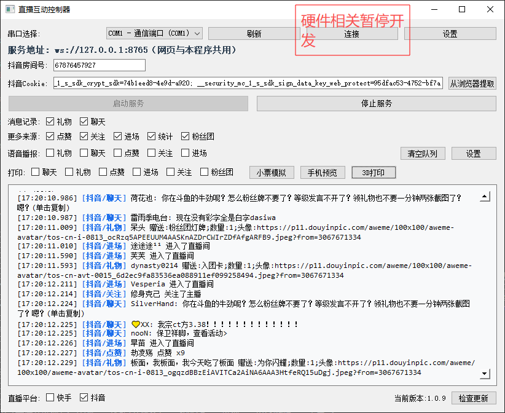
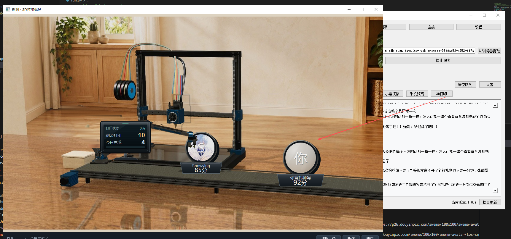
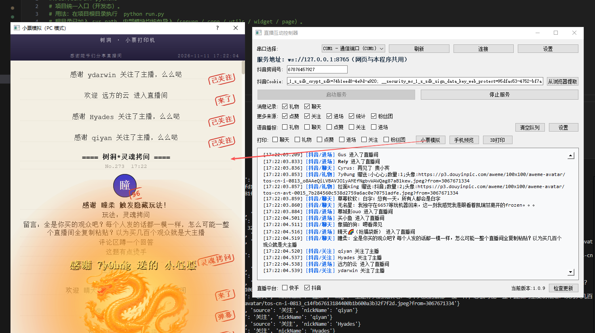
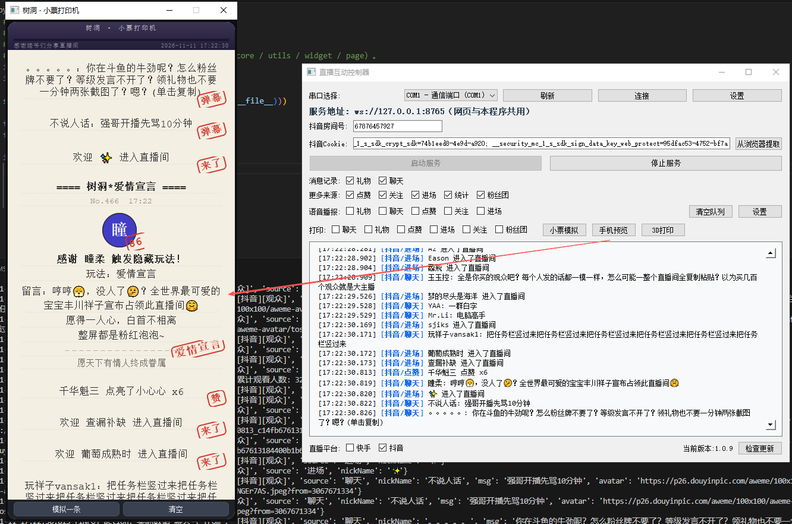

# 🎬 直播互动控制器（live-gui）

> 基于 PyQt5 的抖音直播实时互动工具 · 支持 Windows / macOS · 本地运行，不依赖远程中转服务器

**直播互动控制器**是一款在本地运行的直播实时数据互动软件。它抓取抖音直播间的弹幕、礼物、点赞、进场、关注、粉丝团等实时消息，在桌面上集中展示，并可按类型触发**语音播报**与 **58mm 热敏小票打印**；同时提供**照片级 3D 打印现场动画**与**小票 / 手机预览**，实现丰富的直播互动玩法。

数据仅通过本机进程采集，**不依赖任何远程中转服务器**。使用前请阅读根目录 [LICENSE](./LICENSE) 与免责声明文件。

> 💡 本软件已**移除激活机制**，下载即可直接使用，无需激活码。

---

## ✨ 核心功能一览

| 模块 | 说明 |
|---|---|
| 实时数据采集 | GUI 进程内由 `WebSocketServerD` 抓取直播间消息，内置 WebSocket 服务（默认端口 `8765`）实时推送 |
| 消息展示 | 弹幕 / 礼物 / 点赞 / 进场 / 关注 / 粉丝团 / 统计，每类消息可**独立开关** |
| 语音播报 | TTS 文字转语音，按消息类型独立开关，支持“大礼物优先”插播 |
| 小票打印 | 58mm 热敏小票机（ESC/POS）按事件类型独立打印，异步队列不卡界面 |
| 小票模拟 | PC 端模拟 58mm 小票排版预览，无需真机即可核对内容 |
| 手机预览 | 移动端版式预览，模拟手机上小票的呈现效果 |
| 3D 打印现场 | 照片级实景底图 + 动态打印件，观众消息触发头像圆牌逐层打印 → 机械臂取件投放 → 传送带成品展示 |
| 自动更新 | 内置更新器，检测新版本后自动下载、解压、替换主程序 |
| 串口管理 | COM 串口设备的连接与断开管理 |

---

## 🖼️ 界面一览

### 1. 主界面

主界面集中呈现实时消息流、各类开关（显示 / 语音 / 打印）、直播间配置（房间号、Cookie）、3D 打印与小票模拟入口，以及串口管理。每类消息的“显示 / 语音播报 / 小票打印”均可在界面上独立勾选。



### 2. 3D 打印现场

独立动画窗口，基于照片级实景底图（`assets/images/printer3d_bg.jpg`）叠加动态元素：

- 逐层挤出的**观众头像圆牌**、当前层熔丝高亮；
- 左侧**机械臂**按二连杆逆运动学动作——伸向热床 → 夹爪闭合 → 抬起 → 转向履带 → 松爪放件 → 回待机位（约 2.9 秒一轮），成品在松爪那一刻才交给传送带；
- 落带后成品随传送带**从左向右**匀速运走，多张牌按出片间隔自然排队、右端出画；
- 状态做成固定在左立柱前方的**黑色实物电子屏**（金属外壳 + LCD + 支架），独立显示「打印状态 / 剩余打印 / 今日完成 / 进度」。

窗口底部提供「模拟一条 / 暂停 / 清空」，1280×720 纯画面可直接用 OBS 窗口采集；素材缺失时自动退回程序化场景，窗口不报错。



### 3. PC 小票模拟

在 PC 端按真实 58mm 小票版式排版并预览打印效果，无需连接打印机即可核对内容。



### 4. 手机预览

模拟手机端的小票呈现效果，便于在直播手机上核对排版。



---

## 🔧 使用流程

1. **填写直播间信息**：在界面填入**抖音房间号**（必填），粘贴**抖音 Cookie**（可选，可提升礼物数据获取成功率；可点「从浏览器提取」自动读取本机已登录浏览器的 Cookie）。
2. **启动服务**：点击「启动服务」，程序在本进程内启动唯一的 `WebSocketServerD` 抓取器，开始采集实时消息；「停止服务」结束采集。关闭窗口会自动停止服务与抓取线程。
3. **勾选展示 / 语音 / 打印**：每类消息的“显示 / 语音播报 / 小票打印”均独立勾选，可自由组合玩法。
4. **串口设备**：下拉选择 COM 口 → 「刷新」重新枚举 → 「连接」/「断开」。

> 配置持久化在 `data/app_config.json`，下次启动自动回填房间号与 Cookie。

---

## 🔌 对外接口

数据服务启动后，**对外只暴露一个 WebSocket 端口 `8765`**（全项目唯一），外部页面 / 程序连它即可消费实时互动数据。推送的是抓取器拿到的**原始事件**：不加工、不过滤、不补发，由消费端自行解析。

- 连接地址：`ws://127.0.0.1:8765`
- 连接建立后立即收到一条上线通知：

```json
{"source": "系统", "message": "connected", "timestamp": "2026-10-29T13:00:00"}
```

- 之后每条直播间互动实时推送一条 JSON（即 `WebSocketServerD` 输出的原始 dict），常见字段如下：

| 字段 | 说明 |
|---|---|
| `source` | 事件类型：`聊天` / `礼物` / `点赞` / `进场` / `关注` / `粉丝团` / `系统` |
| `nickName` | 用户昵称 |
| `msg` | 聊天内容（仅 `聊天` 事件） |
| `giftName` / `giftCount` | 礼物名称与数量（仅 `礼物` 事件） |

示例：

```json
{"source": "礼物", "nickName": "小明", "giftName": "小心心", "giftCount": "1"}
```

---

## 🛠️ 安装与打包

### 依赖

```
PyQt5 websockets pyserial requests edge_tts pygame playsound==1.2.2 py_mini_racer
```

### Windows 打包（已验证）

直接双击运行项目根目录的 `scripts/build_win.bat` 即可，脚本已处理好 `py_mini_racer` 的 dll 与 `sign.js` / `a_bogus.js` / `ac_signature.py` 等资源打包，并内置 360 拦截重试。

手动打包参考命令：

```bash
pyinstaller -w -i "logo.ico" ^
  --add-data "sign.js;." --add-data "a_bogus.js;." --add-data "ac_signature.py;." ^
  --add-binary "venv\Lib\site-packages\py_mini_racer\icudtl.dat;." ^
  --add-binary "venv\Lib\site-packages\py_mini_racer\mini_racer.dll;." ^
  --add-binary "venv\Lib\site-packages\py_mini_racer\snapshot_blob.bin;." liveMain.py
```

更新程序单独打包后将 `updater.exe` 与 `liveMain.exe` 放在同一目录：

```bash
pyinstaller -w -i "update.ico" updater_worker.py -n updater
```

### macOS 打包

```bash
pyinstaller -w -i "logo.ico" \
  --add-data "sign.js:." --add-data "a_bogus.js:." --add-data "ac_signature.py:." liveMain.py
```

### 源码运行

```bash
python liveMain.py
```

---

## ❓ 常见问题

| 现象 | 处理 |
|---|---|
| 打包时 `PermissionError: [Errno 13]` 指向 dll | 360 等安全软件实时防护拦截；将项目目录加入信任区或打包时退出安全软件（脚本已内置自动重试） |
| 语音不播报 | 检查对应消息类型的语音开关是否勾选 |
| 小票打印没反应 | 优先用“自动探测”；确认打印机已装官方驱动并出现在系统打印机列表 |
| 启动后无真实事件 | 检查房间号是否正确、Cookie 是否过期（可点「从浏览器提取」重新获取） |

---

## ⚠️ 免责声明

本程序仅从本地代理或本机浏览器获取相关数据，不涉及任何服务器中转；使用者应在合法合规范围内使用，禁止用于违法、滥用、侵权、侵犯隐私等活动。开发者不对数据滥用、隐私泄露、法律纠纷等后果承担责任。完整条款见 [LICENSE](./LICENSE) 与免责声明文件。
