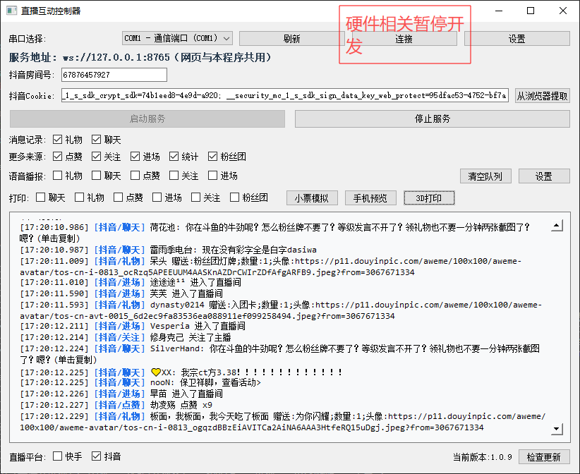
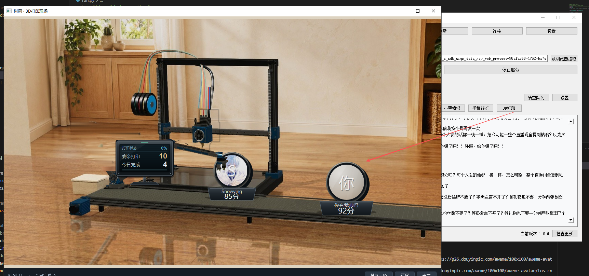
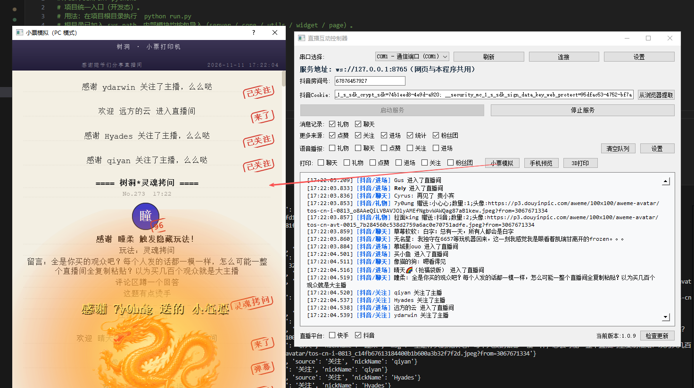
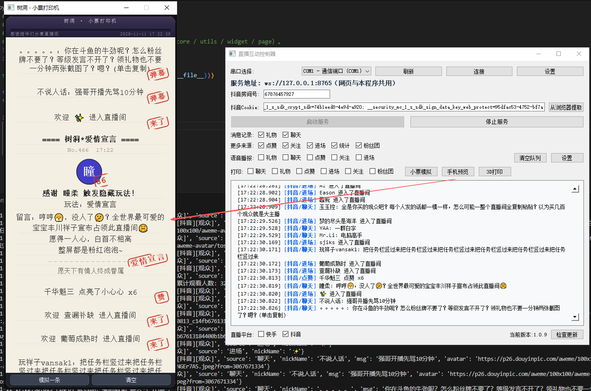

# 🎬 Live Interaction Controller (live-gui)

> A PyQt5-based real-time Douyin (TikTok CN) live-stream interaction tool · Windows / macOS · Runs locally, no remote relay server required

**Live Interaction Controller** is a locally-running real-time live-stream data interaction tool. It captures live-room events such as chat, gifts, likes, enters, follows and fan-club joins, displays them centrally on the desktop, and can trigger **TTS voice announcements** and **58mm thermal receipt printing** by event type. It also provides a **photo-realistic 3D printing scene animation** and **receipt / phone previews** for rich live-stream interaction.

All data is captured by the local process only — **no remote relay server is involved**. Please read the [LICENSE](./LICENSE) and the disclaimer file in the root directory before use.

> 💡 The activation mechanism has been **removed** — just download and use it, no activation code needed.

---

## ✨ Feature Overview

| Module | Description |
|---|---|
| Real-time data capture | `WebSocketServerD` runs inside the GUI process to capture live-room messages; a built-in WebSocket service (default port `8765`) pushes them in real time |
| Message display | Chat / gift / like / enter / follow / fan-club / stats — each type can be toggled **independently** |
| Voice announcement | TTS text-to-speech, independently toggleable per message type, with "big-gift priority"插播 support |
| Receipt printing | 58mm thermal printer (ESC/POS), prints independently per event type via an async queue that never blocks the UI |
| Receipt simulator | PC-side 58mm receipt layout preview — verify content without a real printer |
| Phone preview | Mobile-style preview that simulates how the receipt looks on a phone |
| 3D printing scene | Photo-realistic backdrop + dynamic prints: viewer avatars printed layer-by-layer → robotic arm picks & places → finished item rides the conveyor belt |
| Auto-update | Built-in updater detects new versions and auto-downloads, unzips and replaces the main program |
| Serial management | Connect / disconnect management for COM serial devices |

---

## 🖼️ Screenshots

### 1. Main Window

The main window centralizes the real-time message feed, the various toggles (display / voice / print), live-room configuration (room ID, Cookie), the 3D printing and receipt-simulator entries, and serial management. The "display / voice / print" switches for each message type can be toggled independently in the UI.



### 2. 3D Printing Scene

A standalone animation window built on a photo-realistic backdrop (`assets/images/printer3d_bg.jpg`) with dynamic overlays:

- Layer-by-layer extruded **viewer avatar coins** with current-layer filament highlights;
- A left-side **robotic arm** animated via two-link inverse kinematics — reaches the hot bed → gripper closes → lifts → turns to the belt → releases the part → returns to standby (≈2.9s per cycle); the part is handed to the conveyor only at the release moment;
- After dropping, the finished item rides the conveyor **left-to-right** at constant speed; multiple coins queue naturally by output interval and exit on the right;
- Status is shown on a **physical black LCD screen** fixed in front of the left pillar (metal shell + LCD + bracket), independently displaying "print status / remaining / today's done / progress".

The window footer provides "simulate one / pause / clear"; the 1280×720 pure canvas can be captured directly by OBS. If assets are missing it gracefully falls back to a procedural scene without errors.



### 3. PC Receipt Simulator

Previews the real 58mm receipt layout on the PC side — verify content without connecting a printer.



### 4. Phone Preview

Simulates how the receipt looks on a phone, convenient for checking the layout on the streaming phone.



---

## 🔧 How to Use

1. **Fill in live-room info**: enter the **Douyin room ID** (required) and paste the **Douyin Cookie** (optional — improves gift capture; click "Extract from browser" to auto-read the Cookie from a logged-in local browser).
2. **Start the service**: click "Start Service"; the program launches the single `WebSocketServerD` capturer inside its own process and begins collecting real-time messages. "Stop Service" ends capture. Closing the window auto-stops the service and capture threads.
3. **Toggle display / voice / print**: each message type's "display / voice announcement / receipt print" is independently toggleable — mix and match freely.
4. **Serial devices**: pick a COM port from the dropdown → "Refresh" to re-enumerate → "Connect" / "Disconnect".

> Configuration persists in `data/app_config.json` and is auto-filled on next launch.

---

## 🔌 External Interface

After the data service starts, **only one WebSocket port `8765` is exposed** (unique across the project). External pages / programs connect to it to consume the real-time interaction data. The pushed payload is the **raw event** from the capturer: unmodified, unfiltered, not re-sent — the consumer parses it.

- Address: `ws://127.0.0.1:8765`
- On connect you immediately receive an online notice:

```json
{"source": "系统", "message": "connected", "timestamp": "2026-10-29T13:00:00"}
```

- After that, each live-room interaction pushes one JSON (the raw dict output by `WebSocketServerD`). Common fields:

| Field | Description |
|---|---|
| `source` | Event type: `聊天` / `礼物` / `点赞` / `进场` / `关注` / `粉丝团` / `系统` |
| `nickName` | User nickname |
| `msg` | Chat content (only for `聊天` events) |
| `giftName` / `giftCount` | Gift name and count (only for `礼物` events) |

Example:

```json
{"source": "礼物", "nickName": "小明", "giftName": "小心心", "giftCount": "1"}
```

---

## 🛠️ Installation & Packaging

### Dependencies

```
PyQt5 websockets pyserial requests edge_tts pygame playsound==1.2.2 py_mini_racer
```

### Windows packaging (verified)

Just double-click `scripts/build_win.bat` in the project root. The script handles `py_mini_racer`'s dlls and the `sign.js` / `a_bogus.js` / `ac_signature.py` resources, with built-in retry against 360 interception.

Manual reference command:

```bash
pyinstaller -w -i "logo.ico" ^
  --add-data "sign.js;." --add-data "a_bogus.js;." --add-data "ac_signature.py;." ^
  --add-binary "venv\Lib\site-packages\py_mini_racer\icudtl.dat;." ^
  --add-binary "venv\Lib\site-packages\py_mini_racer\mini_racer.dll;." ^
  --add-binary "venv\Lib\site-packages\py_mini_racer\snapshot_blob.bin;." liveMain.py
```

Package the updater separately and place `updater.exe` next to `liveMain.exe`:

```bash
pyinstaller -w -i "update.ico" updater_worker.py -n updater
```

### macOS packaging

```bash
pyinstaller -w -i "logo.ico" \
  --add-data "sign.js:." --add-data "a_bogus.js:." --add-data "ac_signature.py:." liveMain.py
```

### Run from source

```bash
python liveMain.py
```

---

## ❓ FAQ

| Symptom | Fix |
|---|---|
| Packaging `PermissionError: [Errno 13]` pointing at a dll | Caused by 360-style real-time protection; add the project dir to the trust list or exit the AV during packaging (the script already retries automatically) |
| No voice announcement | Check that the voice toggle for that message type is enabled |
| Receipt printer does nothing | Prefer "auto-detect"; make sure the printer's official driver is installed and it appears in the system printer list |
| No real events after starting | Check the room ID is correct and the Cookie hasn't expired (click "Extract from browser" to re-fetch) |

---

## ⚠️ Disclaimer

This program only obtains related data from a local proxy or the local browser; it does not involve any server relay. Users must use it within legal and compliant boundaries; it is prohibited for illegal, abusive, infringing or privacy-violating activities. The developer is not responsible for consequences such as data abuse, privacy leaks or legal disputes. Full terms are in [LICENSE](./LICENSE) and the disclaimer file.
